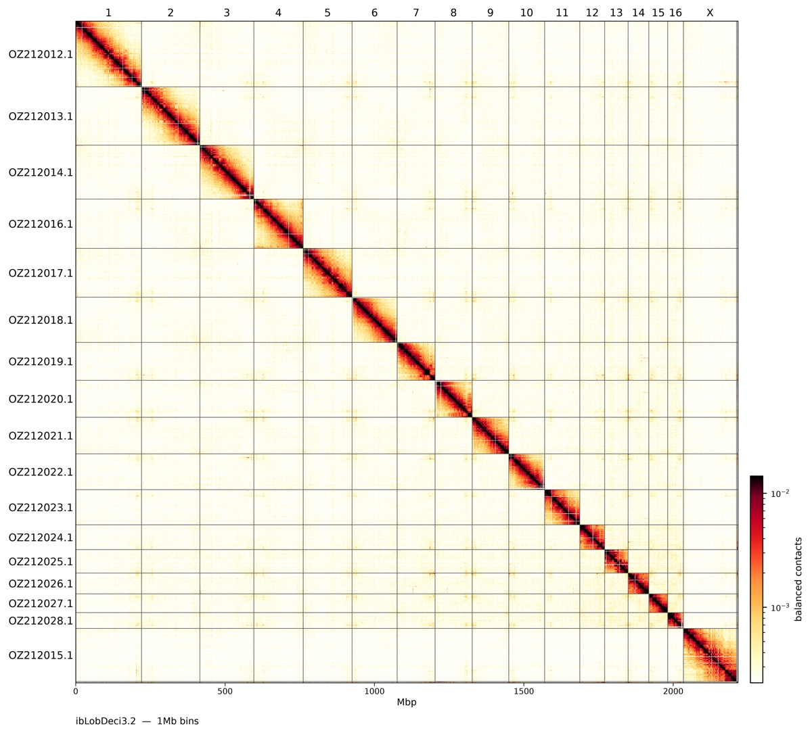

# contactsheet

Publication-ready Hi-C contact maps from a chromosome-level genome assembly and
paired Hi-C reads, in one command. No workflow manager needed.

```
assembly.fa.gz + Hi-C reads
  └─ chromap (Hi-C preset, PCR-duplicate removal)      → <prefix>.pairs.gz
       ├─ cooler cload / zoomify / balance             → <prefix>.mcool   (5 kb … 10 Mb)
       ├─ PretextMap / PretextSnapshot                 → <prefix>.pretext + png
       └─ contactsheet-plot                            → whole-genome + per-chromosome png/pdf
```



*Loboptera decipiens ibLobDeci3.2 (GCA_964662295.2), 1 Mb bins, `--cmap fall`.*

## Features

- **Readable sequence names.** ENA/NCBI headers are simplified while the
  assembly is decompressed: `CHR_1_OZ212012.1`, `MT_OZ212029.1`,
  `Chloroplast_<acc>`, `scaffold_68_CBAAFG020000022.1`. Pre-publication names
  (`SUPER_1`, `CHR_1`, `Chr_1`, `chr_1`) are kept as they are. An old → new
  table is written to `<prefix>.names.tsv`.
- **Chromosomes labelled, everything else not.** Chromosome numbers run along
  the top and accessions down the left (`--label-style split`, as in genome-note
  figures). Unplaced and unlocalised sequences are drawn but not labelled, or
  left out with `--chroms-only`. If no sequence is named like a chromosome, a
  warning is printed and sequences ≥ 1 Mb are labelled instead.
- **True-to-scale whole-genome maps.** Maps are drawn in base-pair coordinates,
  not bins, so sequences shorter than a bin aren't inflated to a full bin. There
  is an Mbp scale along the bottom.
- **Several zoom levels.** Whole-genome maps at about 1000, 2500 and 4000 bins
  across, plus one map per chromosome. Output is 600 dpi PNG plus vector PDF
  (with a rasterised matrix).
- **Colour schemes.** `juicebox` (default), `fall` (cooltools) and `higlass`.
- **Resumable.** Re-running skips mapping if the pairs file already exists.

## Install

Requires conda (or mamba).

```bash
git clone https://github.com/cnag-aat/contactsheet.git
cd contactsheet
./install.sh                         # named env "contactsheet"
./install.sh /shared/conda/contactsheet   # or an env at a prefix path
```

`install.sh` creates the env from `environment.yml` and copies `contactsheet`,
`contactsheet-plot` and `contactsheet-rename` into its `bin/`, so they're on
`PATH` once the env is activated. Re-run it after `git pull`: the env is only
updated if `environment.yml` changed.

On Apple Silicon, some bioconda packages have no native build; prefix the
install with `CONDA_SUBDIR=osx-64`.

## Usage

```bash
conda activate contactsheet
contactsheet ASSEMBLY.fa[.gz] HIC_READ_DIR [OUTDIR]
```

Read pairs are found in `HIC_READ_DIR` by mate suffix: `X.1.fastq.gz`/`X.2.fastq.gz`,
`X_1.fq.gz`, `X_R1.fastq.gz`, `X_R1_001.fastq.gz`, … All pairs are mapped together.

On SLURM, use the wrapper. It only sets resources and activates the env, so
copy it and adjust the `#SBATCH` lines for your cluster:

```bash
sbatch contactsheet.sbatch ASSEMBLY.fa.gz HIC_READ_DIR [OUTDIR]
sbatch --export=ALL,CONDA_ENV=/shared/conda/contactsheet,PLOT_OPTS="--cmap fall" \
       contactsheet.sbatch ASSEMBLY.fa.gz HIC_READ_DIR
```

### Pipeline options (environment variables)

| Variable | Default | Meaning |
|---|---|---|
| `BINSIZE` | 5000 | finest mcool resolution (bp) |
| `MAPQ` | 1 | minimum MAPQ for chromap pairs |
| `RENAME` | 1 | simplify ENA/NCBI headers (0 = keep names as they are) |
| `LABEL_MIN` | 1000000 | size fallback for labelling when no chromosome names are found |
| `PLOT_OPTS` | | extra options for `contactsheet-plot` |
| `PRETEXT_SORT` | nosort | PretextMap `--sortby` (nosort keeps assembly order) |
| `THREADS` | SLURM / nproc | threads |
| `KEEP_TMP` | 0 | keep the uncompressed reference and chromap index |

### Re-plotting

`contactsheet-plot` works on any `.mcool`, so you can redraw figures without
remapping:

```bash
contactsheet-plot hic_maps/asm.mcool -o figs --chroms-only --cmap fall --formats pdf
```

Useful options:

- `--label-style split|combined|number|accession`. `combined` gives `1 (OZ212012.1)`.
- `--cmap juicebox|fall|higlass`.
- `--vmin-pct` / `--vmax-pct`: the colour-scale range as percentiles of non-zero
  pixels. The defaults are 5 (juicebox) or 50 (fall/higlass), and 99.5.
- `--genome-bins` / `--genome-resolutions`: the whole-genome zoom levels.
- `--chrom-max-bins`: per-chromosome resolution.
- `--size`, `--dpi`, `--fontsize`, `--title`, `--no-scale`, `--no-chrom-plots`, `--raw`.

See `contactsheet-plot --help` for the full list.

## Output

```
OUTDIR/
  <prefix>.pairs.gz          chromap pairs (deduplicated)
  <prefix>.mcool             balanced, 5 kb … 10 Mb
  <prefix>.pretext           for PretextView
  <prefix>.names.tsv         new name → original header
  <prefix>.chrom.sizes
  ref/                       .fai (plus reference and index with KEEP_TMP=1)
  plots/
    <prefix>.genome.<res>.{png,pdf}
    chromosomes/<prefix>.<chrom>.<res>.{png,pdf}
    pretext/                 PretextSnapshot images
  *.log
```

## License

MIT, see [LICENSE](LICENSE).
